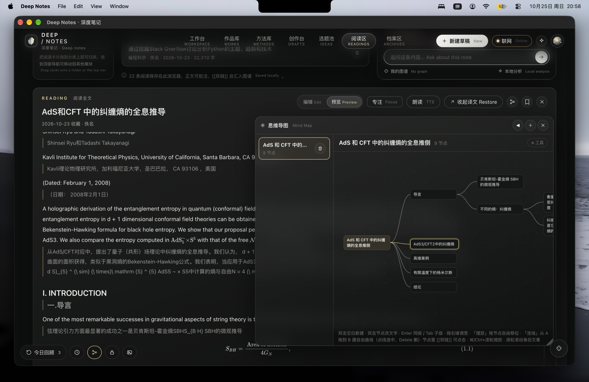

# Deep Notes · 深度笔记

**[下载 macOS 安装包 (.dmg)](https://github.com/TheViviana/Deep-Notes/releases/latest)** · [查看版本与附件](https://github.com/TheViviana/Deep-Notes/releases) · [完整使用教程](docs/使用教程.md)

把你的作品、笔记、选题和草稿，变成一张会呼吸的神经网络：中心是一颗光球，七只发光的水母代表七个模块，点开水母，触须像伞一样展开到每一篇内容；点开一篇，右侧弹出它的全部数据和双向链接。

Turn your works, notes, ideas and drafts into a living neural network — an orb, seven glowing jellyfish modules, umbrella-like tentacles to every piece, and a full analysis panel for each one.

> 仓库里的账号、作品、笔记、选题、草稿**全部是虚构的示例数据**。



## 来源与声明 / Origin & Declaration

**本仓库创建自 [luoluo-121/neural-creator-dashboard](https://github.com/luoluo-121/neural-creator-dashboard)（v0.2.0）**，即原「创作神经网络看板」项目。本仓库（TheViviana/Deep-Notes）是在原项目基础上的修改版，原项目的 Required Notice、LICENSE 与授权沿革全部保留在仓库内（[LICENSE](LICENSE) · [NOTICE.md](NOTICE.md)），感谢原作者与贡献者。

**本软件的全部修改代码由 [Trae CN](https://www.trae.cn/)（AI 编程助手，模型 GLM）通过多轮对话编写完成**，包括功能开发、测试验证与 macOS 打包。原项目界面当年用 Claude 对话写出；本项目在此基础上的一切改动出自 Trae CN。

- 原项目：[luoluo-121/neural-creator-dashboard](https://github.com/luoluo-121/neural-creator-dashboard)（v0.2.0，PolyForm Noncommercial 1.0.0）
- 本仓库：[TheViviana/Deep-Notes](https://github.com/TheViviana/Deep-Notes)（修改版，沿用 PolyForm Noncommercial 1.0.0）
- 开发工具：**Trae CN** —— 默认完全断网，数据不出本机

## 它能做什么

- **工作台**：光球点亮、粒子迸发，背景网络从光球蔓延开，七只水母（作品库、概念网络、方法库、选题池、创作台、阅读区、档案区）围绕光球游动。
- **三层交互**：点水母 → 光球退到左侧、水母列队，触须扇形展开到该模块的每一篇内容；点内容 → 右侧滑出分析栏（指标、收藏率、出链 / 反链 / 双向、话题、二度关联）；Esc 或面包屑逐层返回。
- **问你的图谱**：底部对话框可以问「最核心的内容」「双向连接有哪些」「下一篇写什么」「未创建的笔记」，按本地规则检索，不调用 AI。
- **作品库 / 创作台 / 选题池 / 阅读区 / 档案区**等内页：作品卡片与排序、草稿编辑（支持 `[[` 双链补全）、选题转草稿（转后选题自动移出）、阅读收藏与批注、阅读区分类目录与个人档案。
- **银灰配色**：中性深灰底、银灰光球、香槟金点缀，颜色集中在 `src/neural/theme.js` 和 `neural.css` 顶部的 CSS 变量里。
- **中英双语**界面，尊重系统的「减少动态效果」设置。
- 纯前端，选题、草稿和目标保存在浏览器 `localStorage`，无后台同步服务；桌面版可选启用文件夹知识库，把内容同步成本地 `.md` 文件。

## 本仓库相对原项目的修改

在原项目（v0.2.0）基础上新增与修改（均由 Trae CN 编写）。原项目提供：神经网络图谱底盘、光球与水母动效、五模块（作品库 / 方法库 / 创作台 / 选题池 / 概念网络）、三层交互、本地问答、命令面板与插件底盘。本仓库的改动集中在以下几个方面：

**模块与图谱**

- 新增「阅读区」（外部内容收藏、批注、来源与分类目录）与「档案区」（个人档案全文视图）两个一级模块，图谱、分析栏与导入管线同步扩到七模块。
- 概念网络升级为完整内页（编辑定义与关键词、跳转回工作台）；方法库支持二级分类（子目录分组、拖拽归类、空分类自动清理）；图例即过滤开关、选中内容聚焦邻域等图谱交互增强。

**Markdown 编辑与渲染**

- 全文编辑与预览：`[[双链]]` 补全与图谱汇入、行级混合显示（光标行显源码、其余行呈阅读态）、零依赖代码高亮、专注 / 阅读 / 对照三种编辑视图。
- 渲染增强：KaTeX 数学公式与化学式、脚注、Mermaid 图表、定义列表、上下标、Setext 标题；frontmatter 块标量与特殊值往返保真。
- 编辑体验：富文本粘贴自动转 Markdown、Enter 续行列表、Tab 缩进选区、成对符号智能闭合；改标题自动联动全库双链；「未链接提及」一键转双链；⌘K 批量替换（先预览再应用）。
- 图片与视频：粘贴截图 / 插图按钮、`![[图片]]` 引用（桌面版自动回填）、本地视频内嵌与灯箱播放（只读流式、不占内存）。

**写作与学习工具**

- 创作台闪念箱、今日笔记、写作番茄钟（新增字数实时统计）；⌘K 写作统计（字数曲线、连续天数、模块分布）；每日随机回顾。
- 闪卡复习：概念卡与段落卡共用 Leitner 间隔调度。
- 思维导图：浮动窗口（拖动 / 缩放 / 位置记忆）、从文章结构一键生成、节点增删改 / 拖拽重排 / 折叠 / 五色标记、自由连线、文本大纲双向同步、一键转草稿、导出 PNG、撤销重做。
- 番茄钟与专注白噪音（WebAudio 本地合成）、本地语音朗读（逐段高亮、完全离线）、任务清单（`- [ ]` 勾选回写 + ⌘K 汇总）、笔记模板库、媒体库图片画廊、阅读进度记忆 / 大纲目录 / ⌘F 文内查找、阅读可视进度条。

**知识库与数据**

- 桌面版文件夹知识库：导入时建「`<原名> - Deep Notes`」副本，增删改实时写回 `.md`（删除进 `.trash`，原文件夹不动）；原子写入（fsync + rename）、非破坏性增量写盘、写盘失败留底与重试、文件恢复快照网（对标 Obsidian File Recovery）、外部改动约 2 秒自动同步、iCloud / 云盘占位文件安全处理、多知识库快速切换。
- 导入与导出：PDF / HTML / Word(.docx) / Markdown / TXT 全离线解析、无数量上限；frontmatter 中英文键与全角冒号识别、自定义字段原样保留；一键导出 Markdown / PDF / 整库自包含 HTML / 单篇分享 HTML。
- 数据完整性与性能：写盘操作序号单调递增、在途串行守卫、退出前同步落盘、防抖窗口补写等系统性加固（时钟回拨、慢盘、换库、断电等场景不丢写不误删）；大库性能优化（写盘 diff 跳过、双链计数预计算、窗口失焦自动降帧、减少动态效果节能）。

**AI 助手与插件（可选联网）**

- 自配 OpenAI 兼容 API（key 仅存本机、桌面版钥匙串加密）；流式输出、文件工具、长期记忆、人设；选中正文 AI 菜单（润色 / 总结 / 解释等）；AI 双链建议。
- 插件系统扩展：斜杠命令、打字机模式、双链体检、阅读时长、格式工具栏、大纲目录、模板库、沉浸式翻译（双语对照）。

**桌面版与安全**

- Electron 桌面版（electronizer 生成壳，macOS 免安装 DMG），开屏动画按精密科技感规格重做，全局快捷键唤回窗口与剪贴板速记。
- 安全加固：阅读视图 HTML 转义与协议白名单、CSP 收紧；桌面版 AI 请求经主进程白名单转发（防 DNS rebinding）、窗口导航白名单、知识库根目录须用户亲自授权、路径越界与符号链接校验。

应用默认断网；顶栏有联网开关，「沉浸式翻译」需要打开它才会生成双语对照；「AI 助手」需要联网开关与插件开关同时打开。原项目的 Required Notice 与授权沿革见 [NOTICE.md](NOTICE.md)。


## 快速开始

需要 Node.js 20.19+ 或 22.12+。

```bash
git clone https://github.com/TheViviana/Deep-Notes.git
cd Deep-Notes
npm install
npm run dev
```

打开终端里显示的地址（默认 http://127.0.0.1:5173/ ）。

### macOS 桌面版（免安装 .dmg）

到 [Releases](https://github.com/TheViviana/Deep-Notes/releases) 下载对应芯片的安装包：`Deep Notes-0.2.3-arm64.dmg`（Apple Silicon，M 系列）或 `Deep Notes-0.2.3-x64.dmg`（Intel）。打开后把「Deep Notes」拖进「应用程序」。安装包未做 Apple 开发者签名（仅 ad-hoc 签名），首次打开：

- 若提示「无法验证开发者」：**右键 → 打开**，或在「系统设置 → 隐私与安全性」里点「仍要打开」；
- 若提示「"Deep Notes"已损坏，无法打开」：这是 macOS 对未公证应用的拦截，打开「终端」执行下面命令后即可正常打开（本应用完全开源，可自行从源码构建验证）：

```bash
xattr -cr "/Applications/Deep Notes.app"
```

Apple Silicon（M 系列）与 Intel 芯片各有一个安装包，按机器选择。

## 桌面版构建（Electron · macOS）

用 [electronizer](https://www.npmjs.com/package/electronizer) 生成的 Electron 壳打包，界面与网页版一致、同样不联网。数据保存分两层：`localStorage`（Electron 用户数据目录）始终生效；导入知识库时会在所选文件夹旁新建「`<原名> - Deep Notes`」副本并启用**文件夹写回**——作品 / 方法笔记 / 草稿 / 阅读的增删改实时同步成副本里的 `.md` 文件（删除的内容移入 `.trash`），原文件夹内容不变，「关于这份数据」弹窗可查看当前库路径。

```bash
npm run build            # 构建静态文件到 dist/
npm run electron:dist:mac  # 打包 macOS 应用，产物在 electron-dist/
```

- 产物：`electron-dist/` 下的 `.app`、`.dmg` 和 `.zip`（未签名，首次打开需右键 → 打开）。
- `.app` / `.dmg` 只用于本地安装验证，不进入仓库；正式安装包发布到 GitHub Releases。
- 开发模式：`npm run electron:dev`（同时起 Vite 和 Electron，支持热更新）。
- 主进程与打包配置由 electronizer 生成：`electron/main.cjs`、`electron/preload.cjs`、`electron-builder.json`。

## 让你的 AI 智能体来装（Claude、Codex、Kimi、Cursor……）

仓库自带一个通用格式的 skill（`skills/neural-creator-dashboard/SKILL.md`），一条命令装到你电脑上的智能体：

```bash
npx skills add TheViviana/Deep-Notes
```

装好后对智能体说：

> 用 neural-creator-dashboard 这个 skill，把我的笔记做成神经网络看板，笔记在 <你的笔记文件夹>。

也可以手动安装：把 `skills/neural-creator-dashboard` 整个文件夹复制到对应目录。

| 智能体 | 全局目录 | 项目内目录 |
|---|---|---|
| Claude Code | `~/.claude/skills/` | `.claude/skills/` |
| Codex | `~/.codex/skills/` | `.agents/skills/` |
| Kimi Code CLI | `~/.agents/skills/` | `.agents/skills/` |
| Cursor | `~/.cursor/skills/` | `.agents/skills/` |
| Gemini CLI | `~/.gemini/skills/` | `.gemini/skills/` |
| Qwen Code | `~/.qwen/skills/` | `.qwen/skills/` |

不支持 skill 的智能体，直接对它说：

> 克隆 https://github.com/TheViviana/Deep-Notes ，按仓库里的 AGENTS.md 帮我装好，并导入我的笔记。

## 换成你自己的数据

### 方式一：导入 Obsidian / Markdown 笔记（推荐）

```bash
npm run import -- --vault "<你的笔记文件夹>" --account "<账号名>" --followers 1280
```

- 按文件夹名自动识别：名字含「作品 / works」的是作品，「方法 / 模板 / 流程 / methods」的是方法笔记，「选题 / ideas」的是选题，「草稿 / 创作台 / drafts」的是草稿；也可以用 `--works`、`--methods`、`--ideas`、`--drafts` 指定文件夹。
- 作品数据写在 frontmatter 里，中英文字段都认（`观看/views`、`收藏/saves`、`点赞/likes`、`发布时间/date`、`类型/media`……），支持「1.2万」「12.4%」这类写法。
- 正文的 `[[双链]]` 自动连线；同一个话题标签出现在两条以上内容里，会成为「概念」节点。
- 格式参考 `examples/vault/`，可以先 `npm run import -- --vault examples/vault` 试试。
- 导入结果写到 `src/data/my-data.js`（已在 `.gitignore`，不会被提交）；`npm run import -- --reset` 切回示例数据；`npm run import -- --help` 查看全部选项。
- 导入脚本只读你的笔记、不联网。

### 方式二：在软件里直接导入文件夹

打开「关于这份数据」弹窗（右上角头像），点「导入知识库文件夹」，先选导入去向（按文件夹自动分类，或全部归入某个模块），再选中你的 Markdown / Obsidian 文件夹即可：解析规则与命令行导入一致，未识别的文件夹一律作为方法笔记导入。桌面版会在所选文件夹旁新建「`<原名> - Deep Notes`」副本作为知识库并实时写回 `.md`；网页版只保存在当前浏览器。可随时「切回示例数据」（会停用文件夹写回，盘上副本原样保留）。

### 方式三：手动改数据

1. **`src/config.js`**：品牌名、图谱中心的名字、头像（放进 `public/`）、页脚文字、本地存储的键名前缀。
2. **`src/data/sample.js`**（或你自己的 `my-data.js`）：所有内容数据，字段如下。

| 导出 | 内容 | 关键字段 |
|---|---|---|
| `snapshot` | 账号概况 | `account` 账号名、`followers` 粉丝数、`capturedAt` 数据日期、`source` 来源说明 |
| `posts` / `postContent` | 作品（由 `W(...)` 一次写出） | 指标：`views` `likes` `comments` `saves` `follows` `shares` `impressions` `ctr` `duration`，缺失填 `null`；内容：`body` 正文、`tags` 话题、`media`（`images` / `video`） |
| `notes` | 方法库笔记 | `title`、`path`（第二段是子目录）、`body`（可以写 `[[双链]]`） |
| `seedIdeas` | 选题池 | `title`、`priority`（高 / 中 / 低）、`status`（待写 / 待扩展 / 已转草稿）、`note` |
| `seedDrafts` | 创作台草稿 | `title`、`body`、`source`（来源选题的 id） |
| `concepts` | 概念词表 | `[概念名, [关键词…]]`，换成你所在领域的词 |

改完刷新页面即可。如果浏览器里已经保存过选题和草稿，想看到新的示例数据，可以把 `storagePrefix` 改个名字，或清空该站点的 localStorage。

## 图谱是怎么连起来的

全部在浏览器里由数据推导（见 `src/neural/graph.js`）：

| 连接 | 规则 |
|---|---|
| 目录归属 | 内容属于哪个模块 / 子目录 |
| `[[双链]]` | 笔记与草稿正文里的双链；找不到对应内容的显示为「未创建」 |
| 选题来源 | 草稿记录了来源选题；选题状态为「已转草稿」时反向也成立 |
| 话题标签 | 作品的话题 |
| 正文提及 | 正文出现概念词；至少两条内容提及，才成为概念节点 |
| 双向共振 | 两条内容共同提及 ≥ 2 个概念 |

## 目录结构

```
├── index.html                 页面入口
├── electron/                  Electron 主进程与 preload（electronizer 生成）
├── electron-builder.json      桌面版打包配置
├── AGENTS.md                  写给 AI 智能体的开发说明（CLAUDE.md 指向它）
├── NOTICE.md                  原项目授权说明（保留）
├── skills/neural-creator-dashboard/SKILL.md   通用 Agent Skill
├── scripts/import-notes.mjs   笔记导入；scripts/verify.mjs 自检（npm run verify）
├── examples/vault/            虚构的示例笔记库
├── public/media/              光球与水母视频
├── src/config.js              个性化配置
├── src/data/index.js          数据入口（示例 / 你的数据）
├── src/data/sample.js         示例数据（虚构）
└── src/neural/
    ├── graph.js               图谱推导、布局、本地检索
    ├── Home.jsx               光球、水母、触须场景与三层交互
    ├── NetworkCanvas.jsx      背景神经网络
    ├── Analysis.jsx           右侧分析栏
    ├── pages.jsx              作品库 / 方法库 / 创作台 / 选题池 / 阅读区 / 档案区
    ├── Intro.jsx              开屏动画（星点扩散 → 能量核心 → 波纹 → 发光字样）
    ├── plugins.jsx            插件系统（斜杠命令 / 大纲目录 / AI 助手等）
    ├── importer.js            软件内知识库导入
    ├── main.jsx               页面框架与弹窗
    ├── theme.js               配色与素材路径
    └── neural.css             样式
```

## 部署

```bash
npm run build
```

公开部署前请运行 `npm run import -- --reset`，确认使用虚构示例。`.gitignore` 只阻止源码提交，不能阻止个人数据被打包进网页；导入私人笔记后的构建产物不可直接公开。

`dist/` 是纯静态文件，可以放到任何静态托管（GitHub Pages、Vercel、Netlify、Cloudflare Pages 等）。构建使用相对路径，部署在子路径下也能正常加载。

## 关于素材

- `public/media/orb.mp4`（发光的光球）和 `jellyfish.mp4`（水母）是看板的核心动效素材，用即梦（Dreamina）AI 生成（AI 生成内容），来自原项目。可以换成你自己的视频，但请保留光球和水母本身，`npm run verify` 会检查它们。
- 头像 `public/avatar.svg` 是抽象图形，示例数据全部虚构，与任何真实账号无关。

## 它是怎么做出来的

- **原项目**（luoluo-121/neural-creator-dashboard）：用 Claude 一轮一轮对话写出来，没有一句「万能提示词」——以能用的看板为起点、先说清楚交互、看一次效果提一个具体意见、让 AI 自己打开浏览器检查。
- **本仓库的全部修改**：由 **Trae CN**（AI 编程助手，模型 GLM）以同样的方式多轮对话完成——每轮改动都经过 `npm run verify`、`npm test`、`npm run build` 与浏览器实测，再进入下一轮。

## 使用许可

> **使用许可：学习与非商业使用。** 当前授权政策为 [PolyForm Noncommercial 1.0.0](LICENSE)，不授予商业使用权限。商业使用需另行授权。这是源码公开项目，不是允许任意商业使用的开源许可。
> **历史例外：** 0.1.0 曾以 MIT 发布，旧版已授出的权利不受影响，包括其中未变更的代码。详见 [授权说明](NOTICE.md)。

## License

[PolyForm Noncommercial 1.0.0](LICENSE) · [授权范围、旧版 MIT 与第三方声明](NOTICE.md) · 原项目：[luoluo-121/neural-creator-dashboard](https://github.com/luoluo-121/neural-creator-dashboard)
