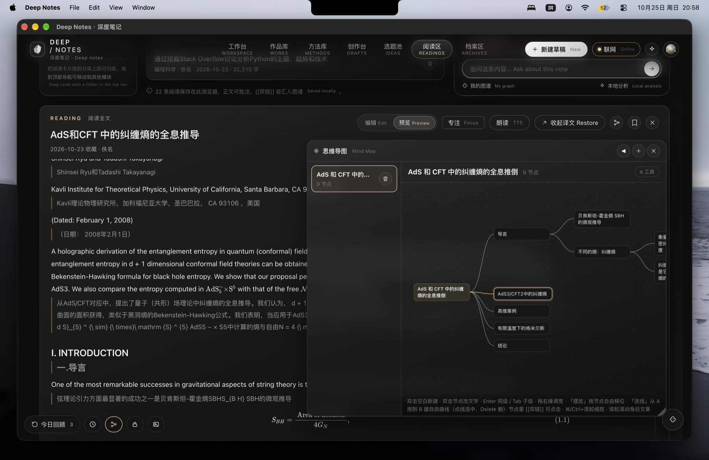

# Deep Notes · 深度笔记

**[下载 macOS 安装包 (.dmg)](https://github.com/TheViviana/Deep-Notes/releases/latest)** · [查看版本与附件](https://github.com/TheViviana/Deep-Notes/releases) · [完整使用教程](docs/使用教程.md)

把你的作品、笔记、选题和草稿，变成一张会呼吸的神经网络：中心是一颗光球，七只发光的水母代表七个模块，点开水母，触须像伞一样展开到每一篇内容；点开一篇，右侧弹出它的全部数据和双向链接。

Turn your works, notes, ideas and drafts into a living neural network — an orb, seven glowing jellyfish modules, umbrella-like tentacles to every piece, and a full analysis panel for each one.

> 仓库里的账号、作品、笔记、选题、草稿**全部是虚构的示例数据**。



## 来源与声明 / Origin & Declaration

**本仓库创建自 [luoluo-121/neural-creator-dashboard](https://github.com/luoluo-121/neural-creator-dashboard)（v0.2.0）**，即原「创作神经网络看板」项目。本仓库（TheViviana/Deep-Notes）是在原项目基础上的修改版，原项目的 Required Notice、LICENSE 与授权沿革全部保留在仓库内（[LICENSE](LICENSE) · [NOTICE.md](NOTICE.md)），感谢原作者与贡献者。

**本软件的全部修改代码由 [Trae CN](https://www.trae.cn/)（AI 编程助手，模型 GLM）通过多轮对话编写完成**，包括功能开发、测试验证与 macOS 打包。原项目界面当年用 Claude 对话写出；本项目在此基础上的一切改动出自 Trae CN。

- 原项目：[luoluo-121/neural-creator-dashboard](https://github.com/luoluo-121/neural-creator-dashboard)（v0.2.0，PolyForm Noncommercial 1.0.0）
- 本仓库：[TheViviana/Deep-Notes](https://github.com/TheViviana/Deep-Notes)（修改版，沿用 PolyForm Noncommercial 1.0.0）
- 开发工具：**Trae CN** —— 默认完全断网，数据不出本机

## 它能做什么

- **工作台**：光球点亮、粒子迸发，背景网络从光球蔓延开，七只水母（作品库、概念网络、方法库、选题池、创作台、阅读区、档案区）围绕光球游动。
- **三层交互**：点水母 → 光球退到左侧、水母列队，触须扇形展开到该模块的每一篇内容；点内容 → 右侧滑出分析栏（指标、收藏率、出链 / 反链 / 双向、话题、二度关联）；Esc 或面包屑逐层返回。
- **问你的图谱**：底部对话框可以问「最核心的内容」「双向连接有哪些」「下一篇写什么」「未创建的笔记」，按本地规则检索，不调用 AI。
- **作品库 / 创作台 / 选题池 / 阅读区 / 档案区**等内页：作品卡片与排序、草稿编辑（支持 `[[` 双链补全）、选题转草稿（转后选题自动移出）、阅读收藏与批注、阅读区分类目录与个人档案。
- **银灰配色**：中性深灰底、银灰光球、香槟金点缀，颜色集中在 `src/neural/theme.js` 和 `neural.css` 顶部的 CSS 变量里。
- **中英双语**界面，尊重系统的「减少动态效果」设置。
- 纯前端，选题、草稿和目标保存在浏览器 `localStorage`，无后台同步服务；桌面版可选启用文件夹知识库，把内容同步成本地 `.md` 文件。

## 本仓库相对原项目的修改

在原项目（v0.2.0）基础上新增与修改（均由 Trae CN 编写）。原项目提供：神经网络图谱底盘、光球与水母动效、五模块（作品库 / 方法库 / 创作台 / 选题池 / 概念网络）、三层交互、本地问答、命令面板与插件底盘；本仓库在其上做出以下全部改动：

**最近更新**

**v0.2.3**（第八轮覆盖更新）

- **数据完整性加固（关键）**：写盘「操作序号」改为**严格单调递增**——系统时钟回拨（NTP 校正 / 手动改时间）后新写的序号不再小于旧写，主进程不会把它们误判成「迟到的旧写」而跳过（此前这类跳过不带任何提示，属于静默丢写）；退出时的同步落盘按**操作先后**执行合并在途批次——「删除某篇（写入在途）后又重建同名笔记」，不会再在 ⌘Q 时执行成「先写入再回收」，把刚重建的笔记直接送进 `.trash`。
- **边界修复**：AI 密钥回填与明文升级不再覆盖用户已经亲手改过或清掉的密钥（删掉的密钥不会被启动时的异步回调重新写回面板与磁盘）；隐私笔记在 800ms 防抖窗口内改回原样即**撤销本次保存**（此前会把中间值照样写回，切笔记时还会补写这份中间值）；一键转双链跳过代码围栏、行内代码与 URL 里的同名字面量（代码示例与链接不再被污染成 `[[双链]]` 写盘）；单文件 HTML 分享把库内视频 / 图片换成可读占位（分享版不留死播放器与破图）。
- **桌面版稳定性**：iCloud 整层目录被卸成占位时整层内容受保护，不再因一次自动同步而消失；库内符号链接不读取、也不进回收站（用户自建的库结构不被同步拆掉）；超大图片 / PDF（超 64MB）拒读并显示占位，不再经 IPC 把两个进程的内存一起打满；知识库切换附带的数据索引改为原子写（崩溃不留半截文件导致白屏）；思维导图收成小球时不再响应 ⌘Z（看不见导图时不静默改数据）；文件恢复界面连点两个版本时，读取慢的旧结果不再覆盖后选的版本；创作台对照栏 / 阅读模式切换内容时库内图片与视频正常回填。

**v0.2.3**（第七轮覆盖更新）

- **数据完整性加固（关键）**：外部编辑器（如 Windows 记事本）给笔记文件加 UTF-8 BOM 后，frontmatter 整段不再失效（`deepnotes-id` 正常读出，不会触发「旧条目消失 + 新条目重建」式的误删重写，自定义键与正文均不丢）；桌面端导入 / 自动同步为无 `date` 字段的内容取**文件真实修改时间**作为日期（此前全算成「导入那一刻」，且跨天重算导致无谓的同步刷新）；写盘队列加**在途串行守卫**——慢盘（iCloud / 网盘）上两轮写盘不再交错（杜绝「trash 晚于 write 落执行把新建文件移进回收站」），在途期间新入队的编辑自动补排一轮落盘，「重试写盘」必等含留底的一轮写完才判定结果；退出前的同步落盘通道同时补写 `.deepnotes/meta.json`（400ms 防抖窗口内的闪念 / 概念改动不再丢盘上版本）。
- **边界修复**：分析栏双链编辑在正文重复出现同一 `[[链接]]` 时按「第几次出现」精确定位（重命名 / 删除不再永远只改第一处），双链目标名自动剔除 `[]` 与换行（不再产出非法双链）；隐私笔记自动保存防抖修复——不再每次按键都触发一次加密落盘 + 全量列表刷新（切笔记 / 锁定 / 关窗时统一补写挂起编辑）；AI 旧版明文密钥升级加密失败时明文不再残留 localStorage；思维导图撤销合并 900ms 内的连续编辑为一步（⌘Z 不再逐字符回退、50 步历史不再迅速耗尽），无效拖放不再压撤销栈；`.markdown` 扩展名与 `.md` 同口径识别（软件内导入 / 命令行导入 / 桌面同步 / 完整性校验四处统一）；macOS 文件名 NFD / 正文 NFC 引用规范化匹配（图片不再因 Unicode 形态差异找不到）。
- **界面文案**：阅读页「试听」按钮补英文副标 Preview。

**v0.2.3**（第六轮覆盖更新）

- **思维导图悬浮交互重塑**：工具栏改为悬停展开——平时只占一行标题高度（右侧「⚙ 工具」提示），鼠标移到标题栏即下拉展开全部按钮、移开即收起，画布空间最大化；**去掉全屏遮罩，导图窗口打开期间底层界面照常可点击、可滚动、可编辑**，窗口浮在内容上方两边同时操作；PNG 导出时节点内的图片缩略图一并画入。
- **媒体库图片可拖入思维导图**：在媒体库页把任意图片卡直接拖到导图节点上——图片以缩略图形式追加进该节点（节点自动放宽并随内容增高）；拖到画布空白处则新建一个图片节点（挂到当前选中节点或中心主题下）；节点文字里的 `![[图]]` / `` 也会就地渲染成缩略图（桌面版自动读取知识库文件回填）。
- **稳定性修复（关键）**：修复思维导图窗口打开即崩溃（`NODE_COLORS is not defined`——导图工具条颜色圆点的模块导入在上一轮重构中被误删，编译期不报错、运行时必炸，整个导图窗口被错误兜底页替换）；修复连线 / 摆放模式下节点文字里的双链按钮拦截鼠标按下、导致整框无法拖动的问题（拖动模式下按钮放行 mousedown、退出模式再恢复点击跳转）；删除节点时同步清理其子树的宽度 / 位置记忆与相关连线，路径 id 复用不再继承残留装饰。

- **思维导图全面升级**：节点文字自动换行、框随内容增高（不再单行省略截断）；节点右缘把手可拖宽（96–460px，双击恢复默认，宽度随导图记忆）；「摆放」模式下拖动节点自由移位（位置随导图记忆，「复位」一键回到自动布局）；同级间距收紧并按真实节点高度紧凑排列，长文字大图不再虚占空间；**导图框内只操作导图**（滚轮平移画布、⌘/Ctrl+滚轮缩放，不再穿透滚动身后内容），导图之外照常操作其他界面与翻阅文章。
- **思维导图撤销 / 重做**：⌘/Ctrl+Z 撤销、⌘/Ctrl+Shift+Z（或 ⌘Y）重做，工具条同款按钮；增删改、拖位、调宽、连线全部可撤销（每图独立 50 步历史，切图清空）。
- **思维导图自由连线**：新增「连线」模式——从节点 A 拖到节点 B 即在任意两者之间建立一条自由曲线（青色，与父子层级线区分，随节点移动自动跟随）；点击连线选中、Delete 删除、双击空白仍可建子节点；导出的 PNG 同样包含自由连线。
- **思维导图其余增强**：节点文字里的 `[[双链]]` 渲染为金色链接，点击直接跳到对应文章 / 笔记（未创建的显示虚线占位）；工具条一键「展开」「收全」（收起折叠到一级分支）；删除节点时同步清理其自由摆放位置、宽度记忆与相关连线，不再留悬空数据。
- **媒体库（图片画廊）**：左下角新增图片入口（⌘K 也有「打开媒体库」）——汇总全库正文里的图片（作品 / 笔记 / 草稿 / 阅读 / 档案，`![[图]]`、``、粘贴图全认），瀑布流一页浏览；同一张图只显示一次，支持按模块筛选与标题 / 文件名搜索；点击图片放大（灯箱）、点击标题跳回原文；单页最多 400 张并明确提示，库内引用图在桌面版自动读取回填。

- **AI 流式输出**：AI 回复逐字实时上屏（「思考中」气泡原地变成打字中的实时文本，带光标闪烁），不再等全部生成完才出现；工具调用轮按增量聚合、完整请求结束后仍走原有确认与落库流程；端点不支持流式时自动回退为一次性输出，浏览器版与桌面版（主进程流式转发，空闲 90 秒自动中止）都支持。
- **图片点击灯箱**：阅读 / 预览模式里点击图片即放大查看（与视频灯箱同一套交互：Esc / 点遮罩 / 点 × 关闭，长图滚动查看，dataURL 粘贴图与知识库引用图都适用）；「阅读全文」弹窗内同样可用，Esc 先关灯箱再关弹窗。
- **AI 模型设置弹层重排**：按「服务商与模型 / 推理等级 / API Key / 人设 / 长期记忆」分区展示（小节标题 + 分隔线，服务商三列网格，弹层限高可滚动），顶栏芯片直接显示当前生效的推理等级徽标；人设带字数统计与保存成功反馈、开关改为滑动开关样式；长期记忆列表带条数徽标、悬停高亮与「只显示最近 12 条」说明，弹层头部常驻联网状态指示；弹层背景近实色处理，动态画面不再透底，文字清晰可读。
- **性能与能耗实测优化**：知识库写盘 diff 按「模块数组引用未变即跳过」（在某模块打字时其余五个模块的逐键 O(n) 比对全部省掉）；作品库双链计数改为每次渲染预计算映射（千卡大库从 O(卡 × 连线) 降到 O(连线)）；AI 消息流单条 memo 化（「思考中」状态翻转不再重渲染全部历史 Markdown）；**窗口失焦自动降帧**——切到别的应用（未最小化）时首页光球 / 水母与背景网络动画从 60fps 降到 ~15fps，实测 CPU 从 ~145%+55% 降到接近 0%，回焦立即恢复全帧率。
- **数据完整性修复**：草稿 / 阅读 / 档案等新建条目的 id 从「纯时间戳」改为「时间戳 + 随机段」——同毫秒连续新建（连点 / AI 工具循环）不再产生重复 id 导致两条内容互相覆盖、一起消失；闪念箱快速连记不再因过期闭包丢条目（函数式更新），删除闪念与段落卡补二次确认；「导入选定内容」的方法笔记路径消歧循环去掉了 8 次上限的静默放行（极端同名批量导入也保证落到唯一路径）；「新建文章」信息弹窗直接关闭时自动撤掉全新且全空的文章（不再残留空条目、连库时不再写出空的 未命名文章.md）；隐私笔记新建后等解密列表落地再选中（固定 50ms 在大库上会抢跑落空）；「阅读全文」弹窗在翻译进行中关闭即停止任务，不再对已卸载组件回填译文；编辑器页脚的保存位置文案如实显示（桌面连库 = 「已实时写入知识库」，网页版 = 「已保存到此浏览器」）。

- **阅读长文四件套**：阅读进度记忆（每篇记住读到的位置，重开自动续读，列表显示「读至 x%」）；大纲目录扩展到「阅读全文 / 预览」模式（导入的整本书可按章节快速跳转）；大纲章节可加 ★ 书签、置顶直达；⌘F 文内查找（命中全部高亮、Enter / Shift+Enter 上下跳转、显示命中数）。
- **编辑与写作效率**：改笔记 / 文章标题自动联动全库 `[[双链]]`（含别名与小节引用，旧名不再断链，逐键输入停手后一次性同步）；方法库「合并」把两篇笔记拼成一篇（正文与双链归并、原件进回收站）；⌘K「批量替换」按范围 / 正则先预览命中再确认应用；编辑器头部新增「反链」栏（哪些内容链接了我，一键跳转）；创作台写作番茄钟（25+5 分钟、本轮新增字数实时显示，切页不中断）。
- **数据与导出**：多知识库快速切换（顶栏下拉，最近连接过的库一键切换、附属数据按库隔离不互相渗透）；⌘K「写作统计」（每日新增字数曲线、连续写作天数、模块字数分布，按库独立记录）；「导出分享版 HTML」把整个知识库打成单个自包含 HTML，发给任何人浏览器直接读；阅读区支持导入 Word（.docx）——零依赖解析（ZIP 中央目录 + 原生解压流 + 自带 XML 解析，标题 / 加粗 / 列表 / 表格 / 超链接文字全保留，损坏文件友好报错、解压限 64MB 防 zip 炸弹）。
- **检索**：⌘K 命令面板支持按内容类型筛选与 `/正则/i` 全文搜索（无效正则自动回退并提示）。
- **每日随机回顾**：每天按日期种子确定性抽 3 条旧内容，左下角入口点开速览、直达原文，防止导入的内容石沉大海。
- **AI 助手增强**：本地长期记忆——对话中让 AI「记住这个」自动存入，也可手动添加或一键导入 `.md`（按章节分条），记忆随知识库 meta 走、跨会话跨设备；人设（画像）可随时启用 / 停用并注入系统提示；上下文放宽（正文节选 8000 字、24 轮对话、工具结果 12k）。
- **界面不再「闪一下」**：修改概念定义、移动文件等纯内容级变化不再重播工作台扇形动画、不再重算整张力导向布局（按节点 / 连接拓扑签名缓存，六类内容全部延迟进图谱），打字与编辑在大库下也不再卡顿。
- **稳定性修复**：写盘队列改为「同条目改名链折叠 + 移动优先」——逐键改标题不再在盘上留下中间标题的孤儿文件，同名新建顶掉旧条目不再丢新内容；切换知识库不再触发骤减守卫误拦与旧库附属数据渗透；文件恢复快照按原文件限额（同目录第 31 篇不再挤掉别人的快照）；macOS 上仅改大小写的改名不再被「目标已存在」误拒；原子写覆盖保留原文件权限；粘贴到刚切换的草稿 / 笔记不再写错目标（挂载期闭包修复）；双链补全菜单跨条目残留不再误插；PDF 导入修复（pdfjs v6 的 `cleanup()` 不兼容导致的必现失败）；CLI 导入跳过符号链接、库根直放文件路径与应用内同口径。

- **第三轮增补**：左下角常驻番茄钟（与今日回顾并排，线条小钟 → 点击展开完整设置——专注/休息时长随意定含 15/25/45/60 快捷档，铃声用本地合成滴滴声或导入任意音频 ≤2MB，到时间响铃并自动进入休息段）；专注白噪音（雨声/溪流/咖啡馆，WebAudio 本地实时合成、专注期间自动播放）；本地语音朗读（预览模式系统语音离线朗读，逐段跟随高亮，可选音色、语速、暂停）；思维导图（独立分类，左下角入口，可直接新建空白导图或从文章/笔记标题结构一键生成——段落按位置归属各节，同一篇重复生成弹确认防覆盖手工编辑，可双向跳转返回原文，画布支持拖拽平移/缩放/节点增删改/折叠持久化）；隐私加密笔记（左下角锁形入口，AES-GCM + PBKDF2 本地加密，密码不落盘、上锁即清密钥，密文随知识库附属数据同步，防抖自动保存+切换/上锁前 flush 不丢内容）；关于弹窗排版精修（按钮等宽网格 + 文字段落折叠展开）。
- **浮动窗口与附属功能收尾**：思维导图改为真正的浮动窗口（样式补全，标题栏拖动、右下角拉伸，位置与尺寸本地记忆，⌘/Ctrl+滚轮缩放，打开期间底层界面锁定、关闭即恢复），旧「思维导图内页」入口与死代码一并移除；导图支持导出 PNG 图片与节点备注（节点文字 `::` 后写备注，仅显示主标题），同级节点间距放宽；阅读区预览底部新增可视进度条（点击轨道任意位置直接快进，进度实时同步，离开后仍记住位置）；隐私区支持加密备份导出 / 导入（备份只含盐与密文、不含密码，同一密码生成的备份可安全合并，密码不同则明确拒绝而不会产生无法解密的黑洞条目）。
- **思维导图交互完善**：打开 / 切换导图自动定位到内容位置（新建导图不再空白、节点不再画出视口外，工具条「⌂」随时回到内容）；双击空白画布直接新建子节点并立刻进入文字编辑，新增 Enter 加同级 / Tab 加子级 / F2 改名 / Delete 删除快捷键；节点支持五色标记（再点取消）与备注条编辑，装饰编码随大纲文本往返、增删兄弟不丢；节点可拖拽重排（防拖入自己的子树，拖到中心主题升为一级）；修复叶子节点后多渲染一个「0」的显示问题，新增子节点追加在末尾、已有节点的折叠态不再错位。
- **番茄钟与隐私区精修**：番茄钟设置面板重新排版——专注 / 休息时长一行一项，快捷档四格一排，铃声与白噪音分组各占一行，窄屏不再折行溢出；隐私区密码卡片规整内边距与按钮区（按钮不再越出卡片），新增笔记搜索与标签（标题 / 正文 / 标签全文检索，标签随密文保存），修复连续切换笔记时可能把上一条内容追写进新笔记的串写问题。
- **分享 · 单文件 HTML**：「关于」弹窗新增把当前打开的那篇导出为自带排版的单文件 HTML（本地图片 / 视频换成可读占位说明，不引用任何外部资源），直接发给任何人浏览器打开即可阅读。
- **思维导图再升级**：中心主题可直接双击改名（根节点即导图标题，改名即时生效）；⌘/Ctrl+滚轮缩放时文字与节点同比缩放，缩小不再显示不全；新增文本大纲面板（工具条「大纲」开合，与画布双向同步——改文字即改图、拖节点即改文本，分割线可拖拽调宽 160–480px 并记忆）；「转草稿」把导图按层级展开成一篇新草稿（一级分支转小节、深层转列表、备注转引用行），写完大纲直接起稿；窗口标题过长省略号收尾，工具条按钮不再被裁切。
- **侧栏收起推广**：方法库「方法笔记」、创作台「我的草稿」、阅读区「分类目录」均可在标题栏一键收起——只留一条细导轨（点导轨随时展开），正文区左移占满，边看内容边开思维导图浮动窗编写互不妨碍；顺手修正方法库右侧空出一条轨道轨距的布局浪费。
- **节能优化**：修复「减少动态效果」模式下首页动画仍在 60fps 空转的问题——该模式下光球水母与背景网络改为静态帧 + 状态变化才重画（实测 CPU 从 ~207% 降至 ~0%）；窗口隐藏或被完全遮挡时两条动画循环整帧跳过，不再后台耗电。

**v0.2.2 及此前**

- **Markdown 往返保真**：frontmatter 支持块标量（`|` / `>`）与需引号值的双向序列化，多行正文、含冒号 / 逗号的标签写回再导入不丢数据；关闭软换行（`breaks:false`），明确区分软硬换行；脚注吸收续行（含空行）。
- **Markdown 渲染增强**：支持 Setext 标题（`===` / `---`，导入 / 大纲 / 镜像层三处统一识别）、定义列表（术语 + `: 定义`）、下标 `~x~`、上标 `^x^`、Mermaid 图表（语法错误回退为代码块不崩）。
- **编辑器体验**：富文本粘贴自动转 Markdown（保留标题 / 列表 / 引用 / 代码 / 表格 / 链接图片）；Enter 自动续行列表（含复选框、数字自增），空行回车退出列表；Tab / Shift+Tab 缩进选区；成对符号自动闭合并支持「键入越过」（`don't` 不多出引号、手动闭合 `[[…]]` 不多出括号），`[` 智能补全 `[[ ]]` 双链；双链补全菜单打开时确认 / 导航键优先交给补全；页面切换保留滚动位置。
- **知识库与图片**：正文图片按内容 sha1 存 `attachments/`，同图只存一份，写入走与正文同口径的原子写入；新增「校验知识库完整性」（⌘K，sha256 比对盘上文件，仅报告差异绝不自动覆盖）。
- **桌面端**：全局快捷键 `⌘/Ctrl+Shift+D` 一键唤回主窗口；`⌘/Ctrl+Alt+V` 把剪贴板文本一键存进闪念箱（后台也可用）。左下角常驻角标：今日回顾、番茄钟（`⌘/Ctrl+Alt+V` 剪贴板捕获见上）、思维导图、隐私笔记。
- **编辑与写盘细节修复**：快速连按 `[` 补全 `[[双链]]` 时光标与正文不再错乱；frontmatter 块标量按任意合法缩进原样解析（1 空格缩进不再丢字符），以 `#` 开头的值自动加引号、不再被当成注释吞掉；「校验知识库完整性」执行前先写尽未落盘的编辑，结果不再误报差异。
- **自动同步稳定性**：同步比对与解析器同口径归一化（正文去空白、空指标、日期与标签并集），按条目 id 顺序无关比对——自己写盘引发的文件监听回声不再误判为外部变更，移动、删除、分组等操作不再被同步顶掉；同步采用盘上内容时界面原地更新，不跳回工作台、不关闭弹窗，仅清掉已被外部删除条目的选中态。
- **分类与监听修复**：分类写盘竞态修复——写盘在途期间新到达的分组改动不再被回吞，新建分组稳定落盘；文件监听过滤 `.deepnotes/` 附属数据与 `.trash` 回收站的自身变更，不再触发多余的全库同步。

**模块与图谱**

- **新增两个一级模块**：「阅读区」（收藏外部内容，带批注、来源与左侧分类目录，卡片可拖拽归类）与「档案区」（第七只水母，个人档案全文视图），图谱、分析栏与导入管线同步扩到七个模块。
- **概念网络升级为完整内页**：概念卡片可展开编辑定义与关键词、点击概念回到工作台图谱选中、「还有 x 条」跳概念清单页（原为跳工作台）；导入 / 自动同步带回的概念词表按名字合并——应用内手动增删的概念与改过的关键词不被覆盖。
- **方法库二级分类**：按子目录分组展示（子目录层级不限，导入不再压平深层目录、同名不再互相覆盖），分类可增删改（删除非空分类内容自动移入「未分类」），笔记与分类间拖拽归类、拖到顶栏跨模块移动，全程纯 state 无刷新；方法库与阅读区的分类里最后一条内容被移走 / 删除时，空分类自动移除，不留空分组。
- **图谱交互增强**：图例即过滤开关（点击隐藏 / 显示某类节点），选中内容时图谱聚焦其邻域（非邻接降透明）；选题池选题转草稿后自动移出、重复转入直接打开既有草稿，草稿保留来源记录可回看；选题平台 / 优先级 / 状态 / 备注编辑与删除；布局迭代次数随节点规模自适应（千节点级知识库不再卡顿数秒）。

**写作与编辑**

- **Markdown 全文编辑与预览**：`[[双链]]` 补全并汇入图谱，未创建的双链可一键创建为文章或笔记；行级混合显示（光标所在行显示 Markdown 源码、其余行呈阅读态）、代码块与行内代码零依赖语法高亮（十六进制颜色附带色块预览）、工具栏文字颜色（七色 + 高亮 `==标记==`）；草稿编辑器三种视图：专注（隐藏左右卡片）/ 阅读（渲染视图）/ 对照（双文件分屏，分割线可拖动）。
- **公式与学术排版（全本地）**：KaTeX 渲染数学 / 物理公式（`$…$`、`$$…$$` 等）与化学式（`\ce{}`，mhchem），CSS 与字体随包内置；脚注 `[^key]` 编号上标 + 文末定义区；`> [!note]` 等标注块转加粗标题；坏公式回退原文不崩。
- **图片支持**：编辑器「插图」按钮与直接粘贴截图（压缩成 dataURL 写进正文）、`![[图片.png|宽度]]` 嵌入引用（桌面版自动读知识库文件回填，网页版显示占位）、导入知识库时图片等资源一并带走。
- **本地视频**：`![[课程.mp4|480]]` 或 `` 直接内嵌播放器，表格里的 `[文件名](x.mp4)` 点击弹出灯箱播放；桌面版经只读流式协议读知识库文件（支持拖动进度条、不把整部视频读进内存），工作副本找不到时回退原库读取，视频不复制进副本以免体积翻倍；网页版显示占位提示。
- **创作台闪念箱**：随手记想法按天分组，一键转草稿 / 方法笔记；「今日笔记」按日期建立或打开每日草稿。
- **未链接提及**：分析栏列出他篇正文以纯文本提到本篇标题的位置，一键全部转 `[[双链]]`（已有双链段落不动）。

**学习与复习**

- **闪卡复习**：概念网络页头「开始复习」进入闪卡，分「概念卡」与「段落卡」两类（段落卡来自编辑器选中文本「存为闪卡」），共用同一条 Leitner 间隔调度曲线（记得 / 模糊 / 忘了；选「模糊」间隔也会温和增长，不会一直卡在同一天）。

**导入 / 导出**

- **导入无数量上限**：文章字数、笔记、阅读、档案、标签、概念全部不设上限（概念按出现次数排序）。
- **frontmatter 识别增强（两侧同一套规则）**：命令行导入与应用内导入共享同一份规则模块（`src/neural/vaultRules.js`），永不分叉——全角冒号（「标题：甲」不再静默丢失）、`updated` 编辑日期随内容往返、作品指标中文键（涨粉 / 分享 / 曝光 / 封面点击率 / 平均观看时长）与英文键同识别（含 `5.1万` 简写与 ctr 小数）。
- **本地文件导入阅读区**：PDF / HTML / Markdown / TXT 全离线解析，不联网；中日韩 PDF 自带字符集映射与标准字体（`public/pdfjs/` 随包，未嵌入字体的中文 PDF 不再乱码）；PDF 超 100MB 拒绝、超 500 页只取前 500 页并在文末显式标注，解析完即释放内存。
- **导入选定内容**：工作台「关于这份数据」（或 ⌘K）可挑多个 `.md` 文件按模块合并导入——同标题的更新内容（空字段不覆盖已有值），新标题的追加为新条目；阅读区分类（frontmatter `folder`）一并读回，重导入不丢分类。
- **桌面版文件夹知识库**：导入时在原库旁新建「`<原名> - Deep Notes`」副本（原文件夹不动，Obsidian 可直接打开副本），之后的增删改实时写回副本里的 `.md` 文件（删除的内容进 `.trash`，超期 30 天自动清理）；**非破坏性增量写盘**——原子写入（先 fsync 落盘再 rename，不留半截文件、断电也不丢，崩溃残留的临时文件超 1 小时自动清理）、空内容拒绝覆盖已有文件（带 `deepnotes-id` 标识的「用户清空正文」放行）、重命名走原子移动（不污染 `.trash`）且拒绝静默覆盖已有目标（源已移走的重试按成功放行）、写盘失败自动重试一次并明确报错、同一文件先移动 / 移出再写入多个操作都执行、导入 / 换库前自动留存数据快照（⌘K「恢复数据快照」可回滚）；**重导入不误删**——新旧内容按路径比对，同一位置换了内容直接覆写而不是先移进回收站，重导入、增删笔记不再连带丢文件；**frontmatter 原样保留**——笔记里自己写的自定义字段（如「主题：」「分类：」）写回时原样落盘，不会被改写或丢弃；**云盘安全**——iCloud / 网盘未下载的文件读不到时，手动导入直接中止、绝不当作「已删除」写回，自动同步跳过该占位文件、其余内容照常对齐；**写盘失败的编辑不会丢**——连续两次写盘失败的操作留底（localStorage 写满时自动转存 IndexedDB），下次启动先不自动同步、顶栏横幅提供「重试写盘 / 放弃」，避免文件夹版本覆盖掉未落盘的修改；之后任何一次成功写盘都会自动补写留底内容，留底不会被静默清掉；**文件恢复快照网（对标 Obsidian File Recovery）**——覆盖库内已有文件前，盘上旧内容自动进本机快照库（应用数据目录下按库分目录，与知识库文件夹分离，保留 7 天、每文件最多 30 份，内容没变不重复留，快照失败绝不阻塞正常写盘）；外部同步用文件版本覆盖界面内容前，内存版本也先留应用内快照（IndexedDB，每条最多 15 份）；「关于这份数据」弹窗或 ⌘K「文件恢复」可按文件 / 条目浏览历史版本、预览正文，**就地恢复**或**恢复为副本**（恢复动作本身也会被快照，可再撤销）——即使发生误覆盖也永远有得找；**外部改动即时感知**——桌面版监听知识库文件夹（macOS / Windows），Obsidian 等外部编辑约 2 秒后自动同步进应用；**单实例运行**——重复打开桌面版会把已有窗口拉到前台，不会出现两个窗口同时写一个库；**关闭即落盘**——退出前写队列同步写完才关窗，刚改完立刻退出也不丢；**每次打开软件自动同步**文件夹变化（文件数骤减超三成视为不完整读取，跳过同步防误删），有改动才提示、无变化静默；选题池同样写进副本（`04-选题池/`，frontmatter 带全部选题字段），清缓存、换设备不再丢选题；删除 / 移动后自底向上清理空目录，库里不留空文件夹；名称自带「 - Deep Notes」后缀的文件夹直接作为工作库不再复制。
- **导出**：正在查看的内容一键导出 Markdown 或 PDF（⌘K 命令面板保留「导出全部 Markdown」）；落盘文件带 `deepnotes-id` frontmatter，再导入不重复，阅读区分类一并落盘。

**AI 助手（可选联网）**

- 接入你自配的 OpenAI 兼容 API（DeepSeek / OpenAI / OpenRouter / 硅基流动 / Ollama 本地等；key 只存本机，桌面版经系统钥匙串 safeStorage 加密后一次性落盘、不存明文（密文没回来前不写盘），加密不可用时明确提示——密钥只留内存、重启后需重填），能感知当前界面内容并直接读写你的文章、草稿与笔记（删除、AI 提出改写标题 / 正文前均需确认），工作台对话坞内嵌对话、其他页面从右下角唤起；Electron 桌面版经主进程转发请求（绕开 CORS；域名先解析成 IP 再校验内网段、90 秒超时、拒绝重定向跟随）。
- **选中 AI 菜单**：选中正文浮出竖向菜单——润色就地替换选区，总结 / 解释 / 延伸 / 定义 / 研究送 AI 面板，底部小输入框可针对选区提问；「AI 双链建议」一键推荐 `[[双链]]`；两者只在联网开关 + AI 插件启用时可用。
- **流式输出**：对话回复逐字实时显示（SSE 流式，桌面版经主进程转发原始字节、渲染层解析聚合；空闲 90 秒自动中止，响应体仍限 10MB）；端点不支持流式时自动回退为一次性输出。

**插件系统**：斜杠命令 / 打字机模式 / 双链体检 / 阅读时长 / 格式工具栏 / 大纲目录（浮动目录，阅读模式同样生效）/ 模板库·支持自定义模板 / 沉浸式翻译·可选联网 / AI 助手·可选联网。

**数据与体验**

- **稳定性与数据一致性**：方法笔记的新建 / 改名 / 跨分类移动统一做路径查重（同名自动追加编号，连点多次或在同一毫秒内新建也不会写到同一个 `.md`），且路径分配全部挪进 setNotes updater，快速连点 / 拖拽连点不再撞路径；path 缺失或不含 `.md` 时有兜底扩展名与有界循环，杜绝死锁冻结；选题 id 优先沿用 `deepnotes-id`、缺失时按标题稳定散列，增删文件后不再整体漂移；草稿来源选题随文件往返（落盘写 source frontmatter），id 兼容标题与旧数字写法；导入会跳过 `.trash` / `.obsidian` 等隐藏与缓存目录；写盘队列遇到同一文件的新旧操作时以最新编辑为准，挂起留底只填空位、绝不顶掉新内容；附属数据 `.deepnotes/meta.json` 写前重读盘上版本并只覆盖本机改过的键（列表类按条目合并），未改动的键以盘上为准、对面机器的概念定义 / 复习进度不被抹掉，多台机器交替编辑不互相抹掉；文件快照按时间戳数值排序，「最新一份」判定不再错位，恢复界面会等本机快照库读回后再显示；iCloud 占位文件按磁盘真实路径匹配，标题与文件名不一致的条目同步时不再被误判为已删除；概念提及改为关键词自动机单遍匹配、统计指标先建索引，大型知识库首屏不再被拖慢；翻译请求 12 秒超时、2 路并发、单块失败保留原文且部分失败的结果不写缓存（恢复网络后可重试），PDF 每页解析后立即释放内存；闪卡「打开原文」与翻面、插图格式与体积校验、模板保存失败等交互边界一律走顶栏提示条，不再模态阻塞；meta 读写失败也会弹出全局提示，不静默丢概念定义 / 闪念箱；「阅读全文」弹窗内的 `[[双链]]` 就地打开目标内容（与文章预览一致）并自动关闭弹窗，不再误跳工作台、页面也不在弹窗背后偷偷切换；防抖写盘队列同键操作按时间序执行，「写→删→再写同名」不再出现新内容落盘即被吞；回收站超期清理以文件进回收站的时间起算，刚删除的老文件有完整恢复期；原子写入任何一步失败都清理临时文件；附属数据文件损坏时如实报错并停止覆盖，盘上内容不被静默抹掉。
- **数据本地持久化**：文章数据存 `localStorage` 并支持增删改查（含浏览 / 点赞 / 曝光等数据指标与媒体类型的手动修正）；知识库快照全库统计（文章 / 笔记 / 总字数 / 双链数随内容变化）；高频写入带防抖，大库打字不卡；写入带水位检测与写满降级——空间紧张先暂停全量快照保正文，挂起修改留底 IndexedDB 不因存储满丢失；写入失败弹顶栏通知条明确告警，根节点包 ErrorBoundary、全局兜底未捕获异常——渲染出错显示可重载的兜底页，不再静默白屏；内容被意外覆盖（外部同步、同名顶掉等）可从「文件恢复」的两层快照网找回旧版本，笔记安全对齐 Obsidian 的水位。桌面版连接知识库后，内容以盘上 `.md` 为唯一事实源，启动直接读盘；闪念箱、概念定义、复习进度、段落闪卡与手动空分类另存库根隐藏文件 `.deepnotes/meta.json`，随知识库一起搬走。
- **安全加固**：阅读视图转义内联 HTML（格式栏插入的文字颜色 / 下划线成对还原正常显示，其余任意 HTML 一律按纯文本，未闭合代码围栏等边角场景经双层防护同样不漏）、链接与图片按协议白名单放行，公式占位符不会进入任何属性值（双链目标、图片 / 视频地址、链接标题），解析后的公式还原无法截断属性或注入节点，CSP 收紧（去掉 `unsafe-inline`、网络请求仅限自身与 https / 本机回环）兜底——导入来路不明的 Markdown 也无法注入脚本；桌面版 AI 请求经主进程白名单转发（仅 https 公网与 http 本机回环、本机回环限常见本地服务端口，拒绝内网 / 保留段地址，域名解析结果二次校验防 DNS rebinding，响应体流式读取、超 10MB 即中止），窗口导航与弹窗白名单（外链只交给系统浏览器打开，整窗不会被导航到外部页面或任意本地文件），知识库读写路径解析真实路径、符号链接越界一律拒绝，知识库根目录必须经系统对话框由用户亲自授权（授权白名单持久化，拒绝的选择也会被记住、不重复追问；导入生成的副本目录首次访问同样需确认一次，渲染层被注入也无法指派磁盘上任意目录让主进程读写），导出 PDF 的隐藏 iframe 禁止脚本执行，并移除了未再使用的 IPC 暴露面。
- **Electron 桌面版**（electronizer 生成壳，macOS 打包，免安装 DMG），开屏动画按精密科技感规格重做（星点扩散 → 能量核心与三轨道环 → 脉冲波纹 → DeepNotes 发光字样），顶栏融入背景、底部问答坞安全带布局；安装包不含运行时依赖（渲染层全量打包，主进程只用内置模块，体积大幅缩小），随附 LICENSE / NOTICE 与第三方许可证，运行时全部依赖打进渲染层、无 node_modules。

应用默认断网；顶栏有联网开关，「沉浸式翻译」需要打开它才会生成双语对照；「AI 助手」需要联网开关与插件开关同时打开。原项目的 Required Notice 与授权沿革见 [NOTICE.md](NOTICE.md)。

## 快速开始

需要 Node.js 20.19+ 或 22.12+。

```bash
git clone https://github.com/TheViviana/Deep-Notes.git
cd Deep-Notes
npm install
npm run dev
```

打开终端里显示的地址（默认 http://127.0.0.1:5173/ ）。

### macOS 桌面版（免安装 .dmg）

到 [Releases](https://github.com/TheViviana/Deep-Notes/releases) 下载对应芯片的安装包：`Deep Notes-0.2.3-arm64.dmg`（Apple Silicon，M 系列）或 `Deep Notes-0.2.3-x64.dmg`（Intel）。打开后把「Deep Notes」拖进「应用程序」。安装包未做 Apple 开发者签名（仅 ad-hoc 签名），首次打开：

- 若提示「无法验证开发者」：**右键 → 打开**，或在「系统设置 → 隐私与安全性」里点「仍要打开」；
- 若提示「"Deep Notes"已损坏，无法打开」：这是 macOS 对未公证应用的拦截，打开「终端」执行下面命令后即可正常打开（本应用完全开源，可自行从源码构建验证）：

```bash
xattr -cr "/Applications/Deep Notes.app"
```

Apple Silicon（M 系列）与 Intel 芯片各有一个安装包，按机器选择。

## 桌面版构建（Electron · macOS）

用 [electronizer](https://www.npmjs.com/package/electronizer) 生成的 Electron 壳打包，界面与网页版一致、同样不联网。数据保存分两层：`localStorage`（Electron 用户数据目录）始终生效；导入知识库时会在所选文件夹旁新建「`<原名> - Deep Notes`」副本并启用**文件夹写回**——作品 / 方法笔记 / 草稿 / 阅读的增删改实时同步成副本里的 `.md` 文件（删除的内容移入 `.trash`），原文件夹内容不变，「关于这份数据」弹窗可查看当前库路径。

```bash
npm run build            # 构建静态文件到 dist/
npm run electron:dist:mac  # 打包 macOS 应用，产物在 electron-dist/
```

- 产物：`electron-dist/` 下的 `.app`、`.dmg` 和 `.zip`（未签名，首次打开需右键 → 打开）。
- `.app` / `.dmg` 只用于本地安装验证，不进入仓库；正式安装包发布到 GitHub Releases。
- 开发模式：`npm run electron:dev`（同时起 Vite 和 Electron，支持热更新）。
- 主进程与打包配置由 electronizer 生成：`electron/main.cjs`、`electron/preload.cjs`、`electron-builder.json`。

## 让你的 AI 智能体来装（Claude、Codex、Kimi、Cursor……）

仓库自带一个通用格式的 skill（`skills/neural-creator-dashboard/SKILL.md`），一条命令装到你电脑上的智能体：

```bash
npx skills add TheViviana/Deep-Notes
```

装好后对智能体说：

> 用 neural-creator-dashboard 这个 skill，把我的笔记做成神经网络看板，笔记在 <你的笔记文件夹>。

也可以手动安装：把 `skills/neural-creator-dashboard` 整个文件夹复制到对应目录。

| 智能体 | 全局目录 | 项目内目录 |
|---|---|---|
| Claude Code | `~/.claude/skills/` | `.claude/skills/` |
| Codex | `~/.codex/skills/` | `.agents/skills/` |
| Kimi Code CLI | `~/.agents/skills/` | `.agents/skills/` |
| Cursor | `~/.cursor/skills/` | `.agents/skills/` |
| Gemini CLI | `~/.gemini/skills/` | `.gemini/skills/` |
| Qwen Code | `~/.qwen/skills/` | `.qwen/skills/` |

不支持 skill 的智能体，直接对它说：

> 克隆 https://github.com/TheViviana/Deep-Notes ，按仓库里的 AGENTS.md 帮我装好，并导入我的笔记。

## 换成你自己的数据

### 方式一：导入 Obsidian / Markdown 笔记（推荐）

```bash
npm run import -- --vault "<你的笔记文件夹>" --account "<账号名>" --followers 1280
```

- 按文件夹名自动识别：名字含「作品 / works」的是作品，「方法 / 模板 / 流程 / methods」的是方法笔记，「选题 / ideas」的是选题，「草稿 / 创作台 / drafts」的是草稿；也可以用 `--works`、`--methods`、`--ideas`、`--drafts` 指定文件夹。
- 作品数据写在 frontmatter 里，中英文字段都认（`观看/views`、`收藏/saves`、`点赞/likes`、`发布时间/date`、`类型/media`……），支持「1.2万」「12.4%」这类写法。
- 正文的 `[[双链]]` 自动连线；同一个话题标签出现在两条以上内容里，会成为「概念」节点。
- 格式参考 `examples/vault/`，可以先 `npm run import -- --vault examples/vault` 试试。
- 导入结果写到 `src/data/my-data.js`（已在 `.gitignore`，不会被提交）；`npm run import -- --reset` 切回示例数据；`npm run import -- --help` 查看全部选项。
- 导入脚本只读你的笔记、不联网。

### 方式二：在软件里直接导入文件夹

打开「关于这份数据」弹窗（右上角头像），点「导入知识库文件夹」，先选导入去向（按文件夹自动分类，或全部归入某个模块），再选中你的 Markdown / Obsidian 文件夹即可：解析规则与命令行导入一致，未识别的文件夹一律作为方法笔记导入。桌面版会在所选文件夹旁新建「`<原名> - Deep Notes`」副本作为知识库并实时写回 `.md`；网页版只保存在当前浏览器。可随时「切回示例数据」（会停用文件夹写回，盘上副本原样保留）。

### 方式三：手动改数据

1. **`src/config.js`**：品牌名、图谱中心的名字、头像（放进 `public/`）、页脚文字、本地存储的键名前缀。
2. **`src/data/sample.js`**（或你自己的 `my-data.js`）：所有内容数据，字段如下。

| 导出 | 内容 | 关键字段 |
|---|---|---|
| `snapshot` | 账号概况 | `account` 账号名、`followers` 粉丝数、`capturedAt` 数据日期、`source` 来源说明 |
| `posts` / `postContent` | 作品（由 `W(...)` 一次写出） | 指标：`views` `likes` `comments` `saves` `follows` `shares` `impressions` `ctr` `duration`，缺失填 `null`；内容：`body` 正文、`tags` 话题、`media`（`images` / `video`） |
| `notes` | 方法库笔记 | `title`、`path`（第二段是子目录）、`body`（可以写 `[[双链]]`） |
| `seedIdeas` | 选题池 | `title`、`priority`（高 / 中 / 低）、`status`（待写 / 待扩展 / 已转草稿）、`note` |
| `seedDrafts` | 创作台草稿 | `title`、`body`、`source`（来源选题的 id） |
| `concepts` | 概念词表 | `[概念名, [关键词…]]`，换成你所在领域的词 |

改完刷新页面即可。如果浏览器里已经保存过选题和草稿，想看到新的示例数据，可以把 `storagePrefix` 改个名字，或清空该站点的 localStorage。

## 图谱是怎么连起来的

全部在浏览器里由数据推导（见 `src/neural/graph.js`）：

| 连接 | 规则 |
|---|---|
| 目录归属 | 内容属于哪个模块 / 子目录 |
| `[[双链]]` | 笔记与草稿正文里的双链；找不到对应内容的显示为「未创建」 |
| 选题来源 | 草稿记录了来源选题；选题状态为「已转草稿」时反向也成立 |
| 话题标签 | 作品的话题 |
| 正文提及 | 正文出现概念词；至少两条内容提及，才成为概念节点 |
| 双向共振 | 两条内容共同提及 ≥ 2 个概念 |

## 目录结构

```
├── index.html                 页面入口
├── electron/                  Electron 主进程与 preload（electronizer 生成）
├── electron-builder.json      桌面版打包配置
├── AGENTS.md                  写给 AI 智能体的开发说明（CLAUDE.md 指向它）
├── NOTICE.md                  原项目授权说明（保留）
├── skills/neural-creator-dashboard/SKILL.md   通用 Agent Skill
├── scripts/import-notes.mjs   笔记导入；scripts/verify.mjs 自检（npm run verify）
├── examples/vault/            虚构的示例笔记库
├── public/media/              光球与水母视频
├── src/config.js              个性化配置
├── src/data/index.js          数据入口（示例 / 你的数据）
├── src/data/sample.js         示例数据（虚构）
└── src/neural/
    ├── graph.js               图谱推导、布局、本地检索
    ├── Home.jsx               光球、水母、触须场景与三层交互
    ├── NetworkCanvas.jsx      背景神经网络
    ├── Analysis.jsx           右侧分析栏
    ├── pages.jsx              作品库 / 方法库 / 创作台 / 选题池 / 阅读区 / 档案区
    ├── Intro.jsx              开屏动画（星点扩散 → 能量核心 → 波纹 → 发光字样）
    ├── plugins.jsx            插件系统（斜杠命令 / 大纲目录 / AI 助手等）
    ├── importer.js            软件内知识库导入
    ├── main.jsx               页面框架与弹窗
    ├── theme.js               配色与素材路径
    └── neural.css             样式
```

## 部署

```bash
npm run build
```

公开部署前请运行 `npm run import -- --reset`，确认使用虚构示例。`.gitignore` 只阻止源码提交，不能阻止个人数据被打包进网页；导入私人笔记后的构建产物不可直接公开。

`dist/` 是纯静态文件，可以放到任何静态托管（GitHub Pages、Vercel、Netlify、Cloudflare Pages 等）。构建使用相对路径，部署在子路径下也能正常加载。

## 关于素材

- `public/media/orb.mp4`（发光的光球）和 `jellyfish.mp4`（水母）是看板的核心动效素材，用即梦（Dreamina）AI 生成（AI 生成内容），来自原项目。可以换成你自己的视频，但请保留光球和水母本身，`npm run verify` 会检查它们。
- 头像 `public/avatar.svg` 是抽象图形，示例数据全部虚构，与任何真实账号无关。

## 它是怎么做出来的

- **原项目**（luoluo-121/neural-creator-dashboard）：用 Claude 一轮一轮对话写出来，没有一句「万能提示词」——以能用的看板为起点、先说清楚交互、看一次效果提一个具体意见、让 AI 自己打开浏览器检查。
- **本仓库的全部修改**：由 **Trae CN**（AI 编程助手，模型 GLM）以同样的方式多轮对话完成——每轮改动都经过 `npm run verify`、`npm test`、`npm run build` 与浏览器实测，再进入下一轮。

## 使用许可

> **使用许可：学习与非商业使用。** 当前授权政策为 [PolyForm Noncommercial 1.0.0](LICENSE)，不授予商业使用权限。商业使用需另行授权。这是源码公开项目，不是允许任意商业使用的开源许可。
> **历史例外：** 0.1.0 曾以 MIT 发布，旧版已授出的权利不受影响，包括其中未变更的代码。详见 [授权说明](NOTICE.md)。

## License

[PolyForm Noncommercial 1.0.0](LICENSE) · [授权范围、旧版 MIT 与第三方声明](NOTICE.md) · 原项目：[luoluo-121/neural-creator-dashboard](https://github.com/luoluo-121/neural-creator-dashboard)
